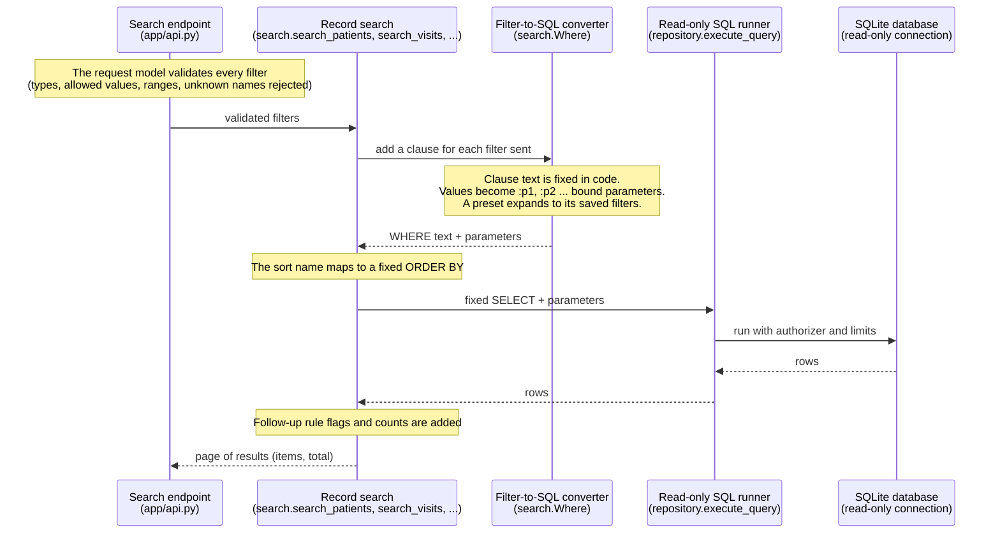
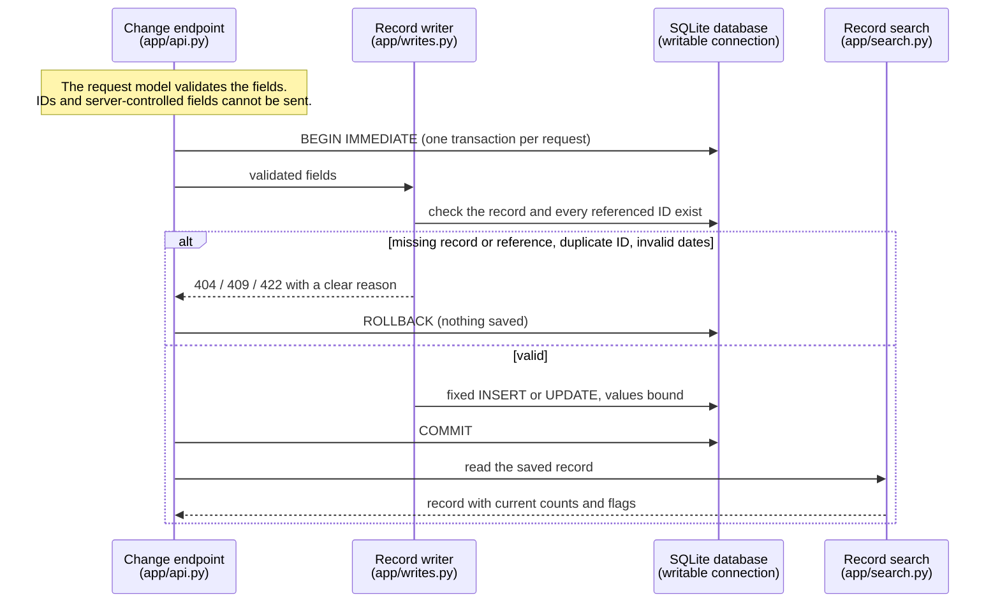
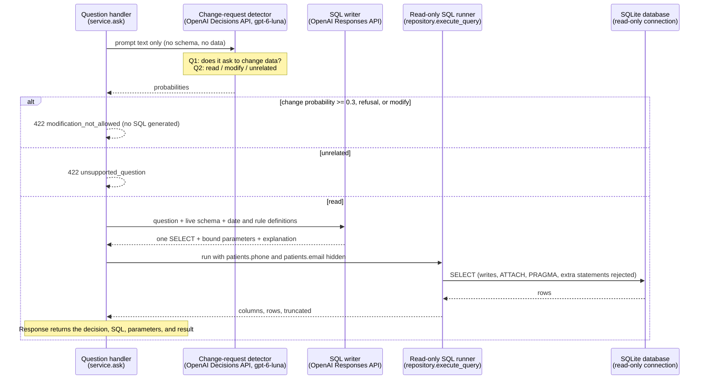
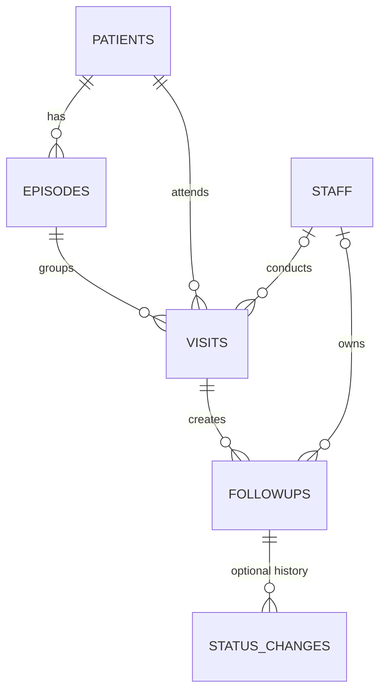

# Visit Follow-Up Tracker

A lightweight clinic operations tool for tracking patient visit follow-ups, identifying actions that need attention, and helping office managers find information using natural-language questions.

> **Project status:** Proposed technical design for the Week 3 team project. This README documents the intended architecture and interfaces; it does **not** imply that every feature has been implemented. **Synthetic data only**—never load real patient records.

**Implemented:** the repository includes a web UI, `/health`, the proposed core SQL schema, sample data, domain constants, development
configuration, Docker Compose, a database initialization script, and tests.
The backend exposes predefined APIs to search, view, create, and update patients,
staff, episodes, visits, and follow-ups, plus read-only natural-language questions
(`/api/ask`), and a web UI for both (see [Web UI](#web-ui)). Bulk data import,
reports, status-change history, and authentication remain planned. See
[Architecture](#architecture).
Run `python scripts/table_generate.py` to initialize the core schema explicitly;
the web app does not apply it automatically.

## 1. Problem and scope

After a patient visit, clinic staff may request a lab test, referral, or recheck. Those actions can be missed when they are stored only in visit notes. Our tool will let a clinic manager see which follow-ups are **overdue**, **due soon**, or **unassigned**, review the patient's visit history, and explicitly mark actions complete.

**In scope:** synthetic data ingestion and validation, follow-up rules, SQLite persistence, a simple web application, read-only natural-language search, reports, tests, Docker, versioned releases, backup, and rollback.

**Out of scope:** diagnosing patients, recommending care, automatically completing/assigning actions, real patient data, production electronic health record integration, and a complex autonomous agent.

## 2. Team ownership

| Owner | Area | Deliverables |
|---|---|---|
| Sanket | Intake and rules | Synthetic data generator, JSON validation, `FollowUp` model, rule classes, unit tests |
| Jihyung | Data and application services | SQLite schema, transactions, queries, reports, follow-up updates, backend endpoints, unit tests |
| Tejdeep | Delivery and integration | Docker/volume, CI, integration test, Git tags, releases 1.0.0 and 1.1.0, database backup/rollback, README, task board |
| Shared | Web and AI workflow | Minimal manager interface, safe natural-language query flow, joint demo |

Assignments for the new web/LLM work are **proposed** and should be agreed on by the team.

## 3. Technical decisions

| Concern | Decision | Why |
|---|---|---|
| Language | Python 3.11+ | Fits the course's Python, OOP, and `sqlite3` requirements |
| User interface | **Web UI** as the primary interface | More usable for an office manager than a terminal |
| Backend | FastAPI + Pydantic | Typed request validation and a small service/API layer |
| Frontend | Minimal server-rendered templates (Jinja2) and JavaScript | Avoid a second, large frontend stack for a one-week project |
| Database | SQLite via Python `sqlite3` | Small, file-based, easy to demonstrate and back up |
| Record IDs | Stable text IDs (`P001`, `E001`, `V001`, `F001`, `S001`) | Readable in demonstrations; all foreign keys use matching text types |
| Relationships | Patient → episode → visit → follow-up | Groups visits by medical issue and connects each action to its originating visit |
| Date storage | ISO 8601 text (`YYYY-MM-DD`); UTC timestamps for events | Sortable strings in SQLite; dates validated in Python |
| Rule execution | Deterministic Python classes, **not** the LLM | Predictable results and easy unit testing |
| Current date | Inject `as_of_date` into rule evaluation | Repeatable tests; normally defaults to today's date |
| Rule defaults | Constants in `app/constants.py` | Keeps the small set of domain defaults in application code |
| LLM role | A decision model rejects prompts that ask to change data; a second model writes **read-only** SQL | The SQLite authorizer, not the model, enforces read-only access and execution limits |
| Write operations | Predefined create/update endpoints with fixed SQL; no deletes; never through the LLM | Changes are explicit staff actions; records are preserved |
| Deployment | Docker, with SQLite on a named volume | Data persists across container replacement |
| Release strategy | Tagged 1.0.0 and 1.1.0 images + Git tags | Reproducible upgrade and rollback |

**Scope caveat:** The original assignment explicitly asks for a CLI and status-change history. This product design prioritizes a web interface and treats the dedicated `status_changes` table as optional. **Both deviations need instructor approval**; otherwise, retain a thin CLI wrapper and implement status-change history (either in `status_changes` or an equivalent append-only audit table) before calling 1.0.0 assignment-complete.

### Architecture

The backend has two kinds of callable operations. Callers never send SQL to either.

| | Predefined API | LLM question (`POST /api/ask`) |
|---|---|---|
| What it can do | **Read and write**: search and view patients, staff, episodes, visits, and follow-ups; create and update them (no deletes) | **Read only**: answer a free-form question |
| What the caller sends | Filter values or record fields | A question in plain language |
| Who writes the SQL | Developers, fixed in `app/search.py` (reads) and `app/writes.py` (writes) | An OpenAI model, inside the server |
| Database connection | Read-only for searches; writable, one transaction per request, for changes | Read-only, always |
| What protects the data | Validated request models, bound parameters, allowlisted columns and sorts, reference checks | Change requests rejected before SQL exists; the SQLite authorizer and read-only connection block writes whatever the model produces; phone and email read as NULL |

Each box in the diagrams below names its role first and the code location in parentheses.

#### Predefined read

Example: `GET /api/patients?q=alice` or `GET /api/followups?preset=overdue&action_type=lab`.
Every record type works the same way with its own filters.



#### Predefined write

Example: `PATCH /api/patients/P001 {"phone": "555-0102"}` or
`PATCH /api/followups/F001 {"status": "done"}`. `POST` creates a record.



#### LLM question (read only)

Example: `POST /api/ask {"question": "Which patients had more than two visits this month?"}`



## 4. Data model

### Relationship overview



### Table responsibilities

| Table | Key columns | Purpose |
|---|---|---|
| `patients` | `patient_id` **PK**, `name`, `phone`, `email` | Synthetic patient identity/contact |
| `staff` | `staff_id` **PK**, `name`, `role` | Doctors, nurses, or coordinators |
| `episodes` | `episode_id` **PK**, `patient_id` **FK**, `description`, `opened_at`, `closed_at` | One medical issue or course of care |
| `visits` | `visit_id` **PK**, `patient_id` **FK**, `episode_id` **FK**, `staff_id` **FK**, `visit_date`, `notes` | One clinic encounter |
| `followups` | `followup_id` **PK**, `visit_id` **FK**, `action_type`, `due_date`, `assigned_staff_id` **FK**, `status`, `completed_at` | Action created during a visit |
| `status_changes` | `change_id` **PK**, `followup_id` **FK**, `old_status`, `new_status`, `changed_at`, `changed_by` | **Optional dedicated audit-history table** (required by original assignment unless equivalent history exists) |

**Important modeling rules**

1. A **visit can create zero, one, or many follow-ups**. Therefore `followups.visit_id` is the foreign key; `visits` does **not** store `followup_id`.
2. A follow-up has one primary key: `followup_id`. Do **not** make `patient_id` another primary key. The patient is found by joining the originating visit.
3. An **episode** groups visits for the same medical issue. Do **not** save a list of future visit IDs in a `visit_dict` column.
4. A visit can be finished while its follow-ups remain open. We do **not** derive follow-up status from visit status. An additional visit-status field is unnecessary for the MVP.
5. `visits.staff_id` is the person handling the encounter; `followups.assigned_staff_id` is the person responsible for the action. They may differ.
6. A follow-up with `assigned_staff_id = NULL` is a **valid** record and triggers the unassigned rule.
7. Visits and episodes must belong to the **same patient**. The composite foreign key below enforces that relationship.
8. An episode is not automatically reopened or linked to a different episode when the same patient returns with an unrelated issue.

### SQLite schema (proposed)

```sql
PRAGMA foreign_keys = ON; -- Execute for EVERY new SQLite connection.

CREATE TABLE IF NOT EXISTS patients (
    patient_id TEXT PRIMARY KEY,
    name       TEXT NOT NULL,
    phone      TEXT,
    email      TEXT
);

CREATE TABLE IF NOT EXISTS staff (
    staff_id TEXT PRIMARY KEY,
    name     TEXT NOT NULL,
    role     TEXT NOT NULL
);

CREATE TABLE IF NOT EXISTS episodes (
    episode_id  TEXT PRIMARY KEY,
    patient_id  TEXT NOT NULL,
    description TEXT NOT NULL,
    opened_at   TEXT NOT NULL,
    closed_at   TEXT,
    FOREIGN KEY (patient_id) REFERENCES patients(patient_id),
    UNIQUE (episode_id, patient_id)
);

CREATE TABLE IF NOT EXISTS visits (
    visit_id    TEXT PRIMARY KEY,
    patient_id  TEXT NOT NULL,
    episode_id  TEXT NOT NULL,
    staff_id    TEXT,
    visit_date  TEXT NOT NULL,
    notes       TEXT,
    FOREIGN KEY (patient_id) REFERENCES patients(patient_id),
    FOREIGN KEY (episode_id, patient_id)
        REFERENCES episodes(episode_id, patient_id),
    FOREIGN KEY (staff_id) REFERENCES staff(staff_id)
);

CREATE TABLE IF NOT EXISTS followups (
    followup_id       TEXT PRIMARY KEY,
    visit_id          TEXT NOT NULL,
    action_type       TEXT NOT NULL
                      CHECK (action_type IN ('lab', 'referral', 'recheck')),
    due_date          TEXT NOT NULL,
    assigned_staff_id TEXT,
    status            TEXT NOT NULL DEFAULT 'open'
                      CHECK (status IN ('open', 'done')),
    completed_at      TEXT,
    FOREIGN KEY (visit_id) REFERENCES visits(visit_id),
    FOREIGN KEY (assigned_staff_id) REFERENCES staff(staff_id)
);

CREATE INDEX IF NOT EXISTS idx_visits_episode_date
    ON visits (episode_id, visit_date);
CREATE INDEX IF NOT EXISTS idx_visits_patient_date
    ON visits (patient_id, visit_date);
CREATE INDEX IF NOT EXISTS idx_followups_status_due
    ON followups (status, due_date);
CREATE INDEX IF NOT EXISTS idx_followups_staff_status
    ON followups (assigned_staff_id, status);
```

**Optional extension — dedicated status-change history:**

```sql
CREATE TABLE IF NOT EXISTS status_changes (
    change_id   INTEGER PRIMARY KEY AUTOINCREMENT,
    followup_id TEXT NOT NULL,
    old_status  TEXT NOT NULL CHECK (old_status IN ('open', 'done')),
    new_status  TEXT NOT NULL CHECK (new_status IN ('open', 'done')),
    changed_at  TEXT NOT NULL,
    changed_by  TEXT,
    FOREIGN KEY (followup_id) REFERENCES followups(followup_id),
    FOREIGN KEY (changed_by) REFERENCES staff(staff_id),
    CHECK (old_status <> new_status)
);

CREATE INDEX IF NOT EXISTS idx_status_changes_followup
    ON status_changes (followup_id, changed_at);
```

When this extension is enabled, changing `followups.status` and inserting into `status_changes` must happen in **one transaction**. Without this table **or equivalent append-only status history**, the application can show past visits and current follow-up statuses, but **cannot reconstruct past status changes**; that does not meet the original brief's history requirement.

### How related visits work

| Episode | Patient | Visit | Meaning |
|---|---|---|---|
| E001 | P001 | V001 | Initial leg-injury visit |
| E001 | P001 | V002 | X-ray review for that injury |
| E001 | P001 | V003 | Recheck after medication |
| E002 | P001 | V004 | Unrelated issue a year later |

To retrieve all visits for the original leg injury:

```sql
SELECT visit_id, visit_date, staff_id, notes
FROM visits
WHERE episode_id = 'E001'
ORDER BY visit_date, visit_id;
```

**Grouping is different from causation.** Sharing `episode_id` tells us V001–V003 concern the same issue; it does not necessarily prove V001 directly caused V002. If the team later needs to track which follow-up resulted in which return visit, add a separate link between the fulfilled follow-up and the resulting visit. Do not add that complexity to the MVP without a concrete use case.

## 5. Input format and validation

The importer reads one JSON file containing synthetic patients, staff, episodes, and visits, with follow-ups nested under their source visit. The loader converts these records into validated Python models before persisting them.

`data/sample_visits.json` (example):

```json
{
  "patients": [{"patient_id": "P001", "name": "Sample Patient"}],
  "staff": [{"staff_id": "S001", "name": "Dr. Example", "role": "doctor"}],
  "episodes": [{
    "episode_id": "E001", "patient_id": "P001",
    "description": "Synthetic leg-injury case", "opened_at": "2026-10-15"
  }],
  "visits": [{
    "visit_id": "V001", "patient_id": "P001", "episode_id": "E001",
    "staff_id": "S001", "visit_date": "2026-10-15", "notes": "Synthetic visit",
    "followups": [{
      "followup_id": "F001", "action_type": "lab",
      "due_date": "2026-10-20", "assigned_staff_id": null, "status": "open"
    }]
  }]
}
```

**Reject** records with missing required IDs, malformed dates, duplicate IDs, unknown action types, invalid statuses, or references to nonexistent patients/visits/episodes. Report the record identifier or row path plus a clear rejection reason. **Do not reject** a valid, unassigned follow-up: flag it instead.

**Import behavior:** validate records first, summarize rejections, then insert the accepted batch in **one SQLite transaction**. If a database write fails, roll back that batch (no partial saved batch). Import parents before children: patients/staff → episodes → visits → follow-ups. A repeat import must not silently create duplicates.

Rule defaults in `app/constants.py`:

```python
ALLOWED_ACTION_TYPES = ("lab", "referral", "recheck")
DUE_SOON_DAYS = 7
```

The rule engine will use these constants directly; no separate settings file is
needed. Allowed action types must stay consistent with the database's `CHECK`
constraint (or the schema must be updated in a controlled migration).

## 6. Follow-up rules

The rule engine is implemented with a base `FollowUpRule` class and one subclass per rule. **Only open follow-ups are flagged.** Multiple flags may apply to one follow-up.

| Rule | Definition, relative to `as_of_date` |
|---|---|
| `overdue` | `status = open` and `due_date < as_of_date` |
| `due_soon` | `status = open` and `as_of_date <= due_date <= as_of_date + due_soon_days` |
| `unassigned` | `status = open` and `assigned_staff_id IS NULL` |

**Due today counts as due soon, not overdue.** A completed follow-up is not shown as currently overdue even if its due date is in the past. Rules only **flag** records; they never auto-change statuses or decide clinical care.

**Planned 1.1.0 rule:** `due_before_visit`—flag an open follow-up whose due date is earlier than its source visit date. This is a business-rule warning, not a malformed-date parsing error. The team should confirm this specific choice before implementation.

## 7. Backend API

Callers send filter values, record fields, or a natural-language question,
**never SQL**. Predefined SQL is fixed in `app/search.py` (reads) and
`app/writes.py` (writes); every value is a bound parameter, and column names and
sort orders come from server-side allowlists. Natural-language SQL is generated
and executed inside the server on a read-only connection. There is no public
endpoint that accepts raw SQL.

Every record type has the same set of endpoints:

| Method | Route | Function |
|---|---|---|
| `GET` | `/api/{type}` | Search with filters, sorting, and paging |
| `GET` | `/api/{type}/{id}` | One record with its related history |
| `POST` | `/api/{type}` | Create a record (omit the ID to get the next free one) |
| `PATCH` | `/api/{type}/{id}` | Change only the fields sent |

`{type}` is `patients`, `staff`, `episodes`, `visits`, or `followups`. Records are
never deleted: close an episode with `closed_at`, complete or reopen a follow-up
with `status`, and unassign staff with `null`.

| Method | Route | Function | Status |
|---|---|---|---|
| `GET` | `/api/schema` | Current database schema as plain text | Implemented |
| `GET` | `/api/options` | Dropdown values, staff list, date bounds, presets, sorts | Implemented |
| `GET` | `/api/dashboard` | Headline counts for the home screen | Implemented |
| `GET` | `/api/followups/stats` | Counts for filtered follow-ups, optionally grouped | Implemented |
| `POST` | `/api/ask` | Read-only natural-language question | Implemented (needs `OPENAI_API_KEY`) |
| `POST` | `/api/import` | Bulk import of validated synthetic data | Planned |

Interactive API documentation, including every filter and field, is available at
`http://localhost:8000/docs`.

### Web UI

`http://localhost:8000` serves one page (`app/templates/index.html`,
`app/static/app.js`, `app/static/app.css`) with no frontend build step. It calls
only the APIs below.

- **Summary cards:** overdue, due soon, unassigned, open follow-ups, patients,
  open episodes, and recent visits. Clicking a card opens the matching filtered list.
- **Patients, Follow-ups, Visits, Episodes, Staff tabs:** a filter panel
  (dropdowns, checkboxes, date ranges, and sliders that stay off until ticked),
  free-text search, sort, and paging. Results update as filters change.
- **Detail panel:** click a row to see the record with its related history, edit
  it, and add related records (an episode for a patient, a visit for an episode,
  a follow-up for a visit). Follow-ups have one-click **Mark done** / **Reopen**.
  **New** creates a record; leave the ID empty to generate one.
- **Ask tab:** a free-form question answered read only through `/api/ask`. It
  shows the decision, the explanation, the SQL that ran, and the result table;
  change requests are refused with a pointer to the edit screens.
- **As of** date: re-evaluates overdue/due-soon flags and relative filters for
  another day.

### Retrieve the schema

```bash
curl http://localhost:8000/api/schema
```

The response is `text/plain` containing the current `CREATE TABLE` and
`CREATE INDEX` statements, read from the database. It contains no patient records.

### Search records

Every filter is optional and filters combine with AND. List filters repeat the
parameter (`action_type=lab&action_type=referral`) and match any value. Text
filters are case-insensitive partial matches. `as_of_date` (default: today)
controls rule flags and relative-day filters.

```bash
# Find a patient by name, phone, email, or ID
curl 'http://localhost:8000/api/patients?q=alice'

# One patient with every episode, visit, and follow-up
curl 'http://localhost:8000/api/patients/P001'

# Visits by one doctor in October, newest first
curl 'http://localhost:8000/api/visits?staff_name=example&visit_from=2026-10-01&visit_to=2026-10-31&sort=-visit_date'

# Open episodes with three or more visits
curl 'http://localhost:8000/api/episodes?status=open&visit_count_min=3'

# Open labs due within 3 days, assigned to S002
curl 'http://localhost:8000/api/followups?status=open&action_type=lab&due_within_days=3&assigned_staff_id=S002'
```

| Type | Main filters |
|---|---|
| Patients | `q`, `patient_id`, `name`, `staff_id` (seen by or assigned to), `has_open_episode`, visit and follow-up count ranges, last-visit and next-due date ranges |
| Staff | `q`, `staff_id`, `role`, open/overdue follow-up and visit count ranges |
| Episodes | `q`, `patient_id`, `patient_name`, `description`, `status`, `staff_id`, opened/closed date ranges, `days_open_min/max`, visit count range |
| Visits | `q`, `patient_id`, `patient_name`, `episode_id`, `staff_id`, `staff_name`, `staff_role`, `notes`, date range, `visit_within_days`, follow-up count range |
| Follow-ups | `q`, record IDs and names, `action_type`, `status`, `flag`, `unassigned`, `episode_status`, staff roles, due/visit/completed date ranges, `due_within_days`, `days_overdue_min/max`, `completed_within_days`, `preset` |

Patient, staff, episode, and visit searches also accept `flag` and open-follow-up
filters, and every type has its own sort options. Follow-up presets include
overdue, due today, due soon, unassigned, open labs/referrals/rechecks, and
recently completed. `GET /api/options` returns the allowed values, staff list,
and date bounds for building dropdowns and sliders.

List responses are pages: `{"items": [...], "total": 42, "limit": 50, "offset": 0, "as_of_date": "..."}`.
`total` counts all matches; `limit` is at most 1,000.

### Create and update records

```bash
# New patient; the response includes the generated ID (for example P004)
curl -X POST http://localhost:8000/api/patients \
  -H 'Content-Type: application/json' -d '{"name": "Sample Patient", "phone": "555-0100"}'

# Change one field; null clears an optional value
curl -X PATCH http://localhost:8000/api/patients/P001 \
  -H 'Content-Type: application/json' -d '{"email": null}'

# New visit; its patient is taken from the episode
curl -X POST http://localhost:8000/api/visits \
  -H 'Content-Type: application/json' -d '{"episode_id": "E001", "staff_id": "S001", "visit_date": "2026-10-27"}'

# Complete a follow-up and record who did it
curl -X PATCH http://localhost:8000/api/followups/F001 \
  -H 'Content-Type: application/json' -d '{"status": "done", "assigned_staff_id": "S002"}'
```

| Type | Create fields (required in bold) | Update fields |
|---|---|---|
| Patients | `patient_id`, **`name`**, `phone`, `email` | `name`, `phone`, `email` |
| Staff | `staff_id`, **`name`**, **`role`** | `name`, `role` |
| Episodes | `episode_id`, **`patient_id`**, **`description`**, **`opened_at`**, `closed_at` | `description`, `opened_at`, `closed_at` |
| Visits | `visit_id`, **`episode_id`**, `staff_id`, **`visit_date`**, `notes` | `staff_id`, `visit_date`, `notes` |
| Follow-ups | `followup_id`, **`visit_id`**, **`action_type`**, **`due_date`**, `assigned_staff_id` | `action_type`, `due_date`, `assigned_staff_id`, `status` |

Each change runs in one transaction and returns the saved record as the search
endpoints show it. IDs never change after creation. New follow-ups start `open`;
`completed_at` is set by the server when `status` becomes `done` and cleared when
it returns to `open`. Unknown fields, missing references, duplicate IDs, and an
episode closed before it opened are rejected without saving anything.
Status-change history is not recorded yet.

### Natural-language questions

```bash
curl -X POST http://localhost:8000/api/ask \
  -H 'Content-Type: application/json' \
  -d '{"question":"Which doctor had the most rechecks last month?"}'
```

The server makes two separate OpenAI calls:

1. The [Decisions API](https://developers.openai.com/api/docs/guides/decisions)
   (`gpt-6-luna`) sees only the prompt text and answers two questions in one
   request: the probability that the prompt asks to change data, and whether it
   is a `read`, `modify`, or `unrelated` request. It fails closed: a change
   probability of 0.3 or more, or a refusal, counts as `modify` and returns
   `modification_not_allowed` before any SQL is generated. Unrelated prompts
   return `unsupported_question`.
2. A **SQL model** (Responses API) turns accepted questions into one
   parameterized `SELECT`, which the server runs with the restricted executor below.

The response includes the decision (`intent`, `confidence`, `modify_probability`),
generated SQL, bound parameters, a short explanation, and the result (`columns`,
`rows`, `row_count`, `truncated`).

Neither model is a security boundary. Writes are prevented by the read-only
connection and SQLite authorizer regardless of what a model produces, and
`patients.phone` / `patients.email` always read as NULL in generated queries.
`/api/ask` still exposes any other record to whoever can call it, so
authentication is required before real data is used.

### Execution limits and errors

Connections open the database read-only. SQLite authorization allows reads of
application tables and approved SQL functions. Writes, schema changes,
transactions, `ATTACH`, `PRAGMA`, extension loading, internal/unlisted tables,
and multiple statements are rejected. The implementation uses SQLite's
[authorization callback](https://www.sqlite.org/c3ref/set_authorizer.html);
the allowlists are in `app/repository.py`.

Generated queries have a cooperative two-second / one-million-VM-step execution
budget, a 20,000-byte SQL limit, at most 100 result columns, a 1 MB
per-value/row limit, and a 4 MiB response-row budget.

| HTTP status | Meaning |
|---|---|
| 200 / 201 | Search, update, or create completed, including empty results |
| 404 | Requested record not found |
| 409 | A record with that ID already exists, or a constraint conflict |
| 422 | Invalid filters or fields, unknown referenced record, rejected prompt, or unusable/disallowed generated SQL |
| 408 | Generated query exceeded its execution budget |
| 503 | Database unavailable, or natural-language search not configured/unreachable |

Errors use `detail.code` and `detail.message`; invalid request parameters use
FastAPI's standard validation-error list. Predefined endpoints need no model API key.

## 8. Repository layout

The structure below is scaffolded. Modules containing only a TODO docstring are
implementation locations, not completed features. Operational scripts and their
implementation status are listed in `scripts/README.md`.

```text
visit-follow-up-tracker/
├── app/
│   ├── __init__.py
│   ├── main.py                 # FastAPI app / route registration
│   ├── api.py                  # Schema, search, create/update, and /api/ask endpoints
│   ├── models.py               # Pydantic input/output models
│   ├── constants.py            # Allowed actions and due-soon window
│   ├── db.py                   # Read-only and writable connections; PRAGMA foreign_keys=ON
│   ├── schema.sql              # SQLite schema
│   ├── search.py               # Fixed, parameterized search SQL
│   ├── writes.py               # Fixed, parameterized INSERT/UPDATE SQL
│   ├── repository.py           # Restricted read-only SQL execution
│   ├── service.py              # Validated business operations
│   ├── rules/                  # FollowUpRule + subclasses
│   ├── ingestion/              # Loader, validation, synthetic-data helpers
│   ├── ai/                     # Decisions API prompt gate and read-only SQL generation
│   ├── templates/index.html    # Web UI page shell
│   └── static/                 # Web UI script and styles (no build step)
├── data/sample_visits.json     # Synthetic data only
├── scripts/
│   ├── table_generate.py      # Initialize core SQLite tables and indexes
│   └── README.md              # Available and planned operational utilities
├── tests/
│   ├── unit/                  # Schema initialization tests
│   └── integration/           # Search, query, and ask API tests against temporary SQLite
├── presentation/              # Reserved for the team presentation
├── .github/workflows/ci.yml
├── Dockerfile
├── compose.yaml               # Local app + named SQLite data volume
├── .dockerignore
├── .gitignore
├── .env.example
├── .editorconfig
├── pyproject.toml             # Project dependencies, uv, and pytest configuration
├── uv.lock                    # Locked dependencies for uv installations
├── requirements.txt
├── requirements-dev.txt
├── CHANGELOG.md
└── README.md
```

## 9. Local development

Run the application scaffold from the repository root with Python 3.11+:

```bash
uv sync --locked
cp .env.example .env
uv run python scripts/table_generate.py
uv run uvicorn app.main:app --reload --env-file .env
```

Open `http://localhost:8000` for the web UI, `/health` for process
health, or `/docs` for the currently registered routes. Environment files are
loaded only when explicitly requested with `--env-file`; exported environment
variables can also be used directly. `uv sync --locked` creates `.venv` and installs
runtime and development dependencies from `uv.lock`. Commit `pyproject.toml` and
`uv.lock` together when changing dependencies; `.venv` remains ignored. The
requirements files are retained for the existing pip-based Docker/CI setup and
must be kept consistent with the dependency ranges in `pyproject.toml`.

Once the server is running, try the searches in section 7 or use
`/docs`. A newly initialized database returns empty results until synthetic
records are inserted; this change does not implement the data importer.

`table_generate.py` uses only the Python standard library. It creates the five
core tables and four query indexes in `data/followups.db`, preserving existing
records on reruns. Override the path with `--db-path /path/to/followups.db` or an
exported `FOLLOWUP_DB_PATH` (the script does not load `.env`). Schema creation is
atomic; it does not migrate existing tables or create the optional status history
table. Foreign keys must still be enabled for every future database connection.

The following commands remain **planned** until the operational scripts exist:

```bash
python scripts/generate_synthetic_data.py
python scripts/import_data.py --file data/sample_visits.json
```

The import script is an operational utility; **the intended clinic-manager interface is the web application, not a CLI.**

Environment variables:

| Name | Example | Purpose |
|---|---|---|
| `FOLLOWUP_DB_PATH` | `./data/followups.db` | SQLite database path |
| `OPENAI_API_KEY` | *(unset by default)* | Enables `/api/ask`; never commit |
| `OPENAI_MODELS` | `gpt-6.1-sol` | Comma-separated models the key can use; the first writes SQL |
| `OPENAI_SQL_MODEL` | *(optional)* | Overrides the SQL model; prompt checks always use `gpt-6-luna` |

Do not commit `.env`, the working SQLite database, backups, or any credentials.

## 10. Testing and CI

From the repository root, with the local virtual environment activated:

```bash
uv run pytest -q
python -m pip install -r requirements-dev.txt
python -m pytest -q
```

Current tests check startup, schema initialization/discovery, search filters,
presets, sorting, paging, counts, and detail views for every record type; create
and update for every record type, including generated IDs, partial updates,
follow-up completion, reference checks, and rollback; the restricted SQL runner
(joins, aggregates, bound parameters, response limits, rejected writes, execution
budgets, hidden contact columns); and the `/api/ask` decision gate. They use
temporary synthetic databases and a fake assistant, so they make no external LLM
calls. The bulk import/report/history workflow below remains planned.

**Unit tests:** valid/invalid input, unknown action type, invalid date, overdue boundary, due-today behavior, due-soon window, unassigned and multi-flag cases, no-flags report, database foreign keys, and updates.

**Database tests:** use a temporary SQLite database; verify failed batch writes roll back, and (if auditing is enabled) verify the status update and history insert succeed or fail together.

**Integration test:** load the synthetic file → reject invalid rows with reasons → save clean records → run rules → read grouped report → mark a follow-up done → verify saved state and patient history. Document what this test does **not** cover (for example, real clinic systems, real authentication, and external LLM reliability).

**CI:** `.github/workflows/ci.yml` runs `python -m pytest -q` on every pull
request and push to `main`, using Python 3.11 and `requirements-dev.txt` (which
includes the application dependencies). Pytest discovers both test directories
through `pyproject.toml`. The job has read-only repository permissions and a
10-minute timeout. Its explicit check name is `test`; keep that name stable
because branch protection references it.

**Merge gate:** GitHub branch protection for `main` requires a pull request and
the GitHub Actions `test` check to pass, with the PR branch up to date before
merging. These rules also apply to administrators. Configure them under
**Settings → Branches → Branch protection rules**: require a pull request,
require status checks (`test` from GitHub Actions), require branches to be up to
date, and disallow bypassing these settings. Workflow YAML runs the check;
GitHub repository settings enforce the merge gate. CI success is automatic;
requiring a teammate's approving review is a separate setting.

## 11. Docker and data persistence

The container uses Python 3.11 and runs `uvicorn app.main:app` as the non-root
`tracker` user, listening on `0.0.0.0:8000`. SQLite belongs on a **named volume**
mounted at `/data`, with `FOLLOWUP_DB_PATH=/data/followups.db`.

**Teammate setup:** install Git and [Docker Desktop](https://docs.docker.com/get-started/get-docker/)
for your operating system, then start Docker Desktop and wait for its engine to
be ready. Desktop includes Compose; Linux users with Docker Engine can instead
install the [Compose plugin](https://docs.docker.com/compose/install/).
Local Python, a virtual environment, and a separate SQLite installation are not
needed to run the container.

Clone the repository and check that Docker and Compose are available:

```bash
git clone https://github.com/tejdeep-pathipati9/visit-follow-up-tracker.git
cd visit-follow-up-tracker
docker info
docker compose version
```

If you already have a clone, use that checkout. Check out the branch you want
to run before building; before this change is merged, use
`git switch feature/ci-docker-setup`. Compose supplies the database path, so
these Docker commands do not need a local `.env` file or an LLM API key.

Build, explicitly initialize the schema with the existing script, and start the
application using Compose:

```bash
docker compose build
docker compose run --rm app python scripts/table_generate.py
docker compose up -d
curl --fail http://localhost:8000/health
docker compose logs app
```

For day-to-day work, run these commands from the repository root:

```bash
docker compose stop             # Stop the app, keeping the container and data.
docker compose start            # Start the stopped app again.
```

After pulling new code on your chosen branch, run `docker compose up -d --build`
to rebuild and replace the app container while retaining the database. Each
teammate has a separate local database; sample JSON is not imported automatically.
If Docker cannot connect to the daemon, start Docker Desktop (or your Linux
Docker service). If port 8000 is already in use, stop the other local server or
container using that port before starting this app.

Open `http://localhost:8000` for the web UI. Compose manages a
project-prefixed volume such as `visit-follow-up-tracker_followup_data`.
`docker compose down` keeps that volume; `docker compose down --volumes` deletes
it and its database. Keep the same Compose project name to reuse the volume.

Alternatively, build and run directly with Docker:

```bash
docker build -t visit-followup-tracker:dev .
docker volume create followup_data
docker run --rm -v followup_data:/data \
  -e FOLLOWUP_DB_PATH=/data/followups.db \
  visit-followup-tracker:dev python scripts/table_generate.py
docker run -d --name followup-app -p 8000:8000 \
  -v followup_data:/data \
  -e FOLLOWUP_DB_PATH=/data/followups.db \
  visit-followup-tracker:dev
```

The direct Docker commands use `followup_data`, a separate volume from Compose's
project-prefixed volume. Reuse the same volume when replacing a container. Mount
the directory, rather than just the database file, so SQLite sidecar files also
persist. New named volumes inherit `/data` ownership from the image, allowing
the non-root user to initialize and write the database.

Initialization creates missing tables and preserves existing records; it does
not perform schema migrations. The current web scaffold does not read or write
SQLite, and `/health` checks process health only. Container persistence can be
checked with the initializer and Python's `sqlite3`; verification through business
endpoints must wait for the database/service implementation.

`.dockerignore` excludes environment files, local databases and sidecars,
backups, caches, virtual environments, and Git metadata. The image includes the
schema and initializer, with runtime dependencies only. Versioned release
commands in the next section remain examples for future completed releases.

## 12. Releases, upgrade, rollback, and backup

| Version | Intended contents |
|---|---|
| **1.0.0** | Validated ingestion, core rules, SQLite, web reports, follow-up completion, tests, Docker; optional read-only LLM queries |
| **1.1.0** | Everything in 1.0.0 plus the agreed new rule (`due_before_visit` proposed) |

Each release has a Git tag, Docker image tag, and `CHANGELOG.md` entry. **Do not tag a release until tests pass.** Keep 1.1.0 backward-compatible with the existing SQLite schema so the 1.0.0 app can still read its database.

```bash
# Example release-tag workflow; run only when the code is ready.
git tag v1.0.0
git tag v1.1.0

docker build -t visit-followup-tracker:1.1.0 .

# Upgrade by replacing the container but REUSING followup_data.
docker stop followup-app && docker rm followup-app
docker run -d --name followup-app -p 8000:8000 \
  -v followup_data:/data \
  -e FOLLOWUP_DB_PATH=/data/followups.db \
  visit-followup-tracker:1.1.0

# Roll back the application version, with the same persistent volume.
docker stop followup-app && docker rm followup-app
docker run -d --name followup-app -p 8000:8000 \
  -v followup_data:/data \
  -e FOLLOWUP_DB_PATH=/data/followups.db \
  visit-followup-tracker:1.0.0
```

**Rollback verification:** query a known patient/visit/follow-up created before the upgrade and confirm it is still present after returning to 1.0.0. Also confirm the old app starts and reports successfully. Reusing a volume is not itself proof that the older application is compatible with the newer database schema.

**Backup:** use Python `sqlite3.Connection.backup()` to copy a live database into a separate backup file, then run `PRAGMA integrity_check` against the backup (expect `ok`). Do not copy an active SQLite file with ordinary file commands as a substitute for the backup API. Record the backup and restore procedure and test an actual restore against a disposable database; do not overwrite the live database during a demonstration.

## 13. Security, constraints, and known trade-offs

- **Synthetic records only.** This training prototype must never process real patient data.
- Restrict data-changing routes and import operations to authorized staff if deployed beyond a single-user demo. Real clinical use would require a dedicated privacy/security review, access controls, and appropriate compliance measures.
- SQLite is suitable for the demo, not necessarily for high-concurrency multi-user production use.
- Date correctness is enforced by Python parsing because SQLite `TEXT` alone cannot prove a string is a valid calendar date.
- The `episodes` table adds useful visit grouping but is an enhancement beyond the minimum training brief.
- The LLM is an interface convenience, not the source of truth. The rule engine and SQL query layer determine results.
- A dedicated `status_changes` table is **optional in this proposed product scope** but **not optional under the original assignment without an equivalent event history**.
- Replacing the required CLI with a web UI is a proposed change that requires instructor approval; a thin CLI can call the same service layer without duplicating business logic.

## 14. Definition of done

- [ ] Synthetic file generator produces clean, invalid, overdue, due-soon, and unassigned examples.
- [ ] Validation reports rejection reasons and clean records are saved atomically.
- [ ] Relationships are enforced, including episode/patient consistency and enabled foreign keys.
- [ ] Overdue, due-soon, and unassigned flags work with deterministic tests.
- [ ] Clinic manager can view reports, search history, and explicitly complete follow-ups.
- [ ] Read-only LLM queries (if included) pass database authorization and execution limits.
- [ ] Every required unit test and full-path integration test passes in CI.
- [ ] SQLite persists across container replacement.
- [ ] Versioned 1.0.0 → 1.1.0 → 1.0.0 demo preserves existing records.
- [ ] Backup passes `PRAGMA integrity_check`, and restore is tested.
- [ ] `CHANGELOG.md`, PR links, task board, and team presentation are ready.
- [ ] Instructor confirms approval for any deviations from the CLI/history requirements—or those requirements are implemented.

---

**Team 3:** Sanket Deshmukh · Jihyung Park · Tejdeep Pathipati
