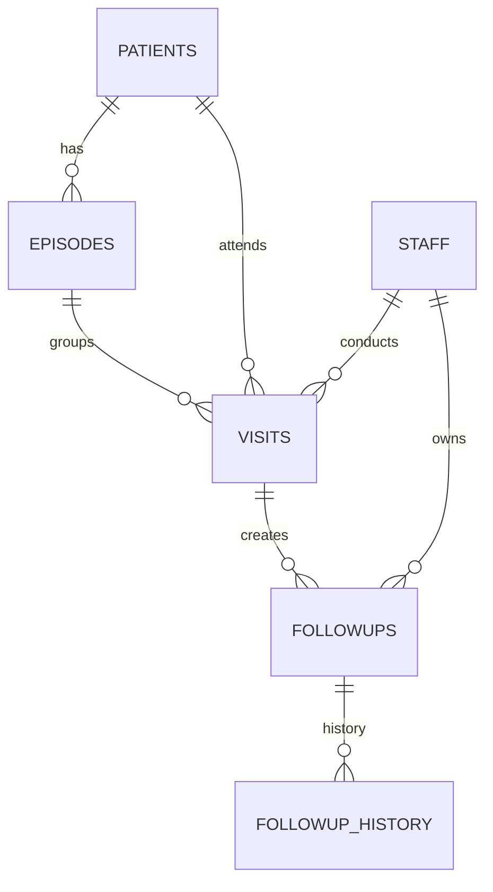
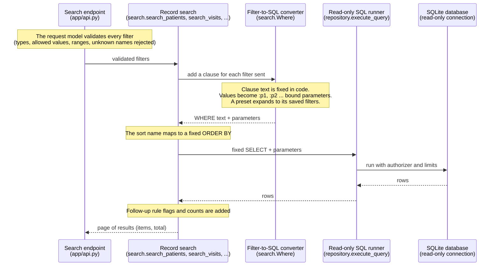
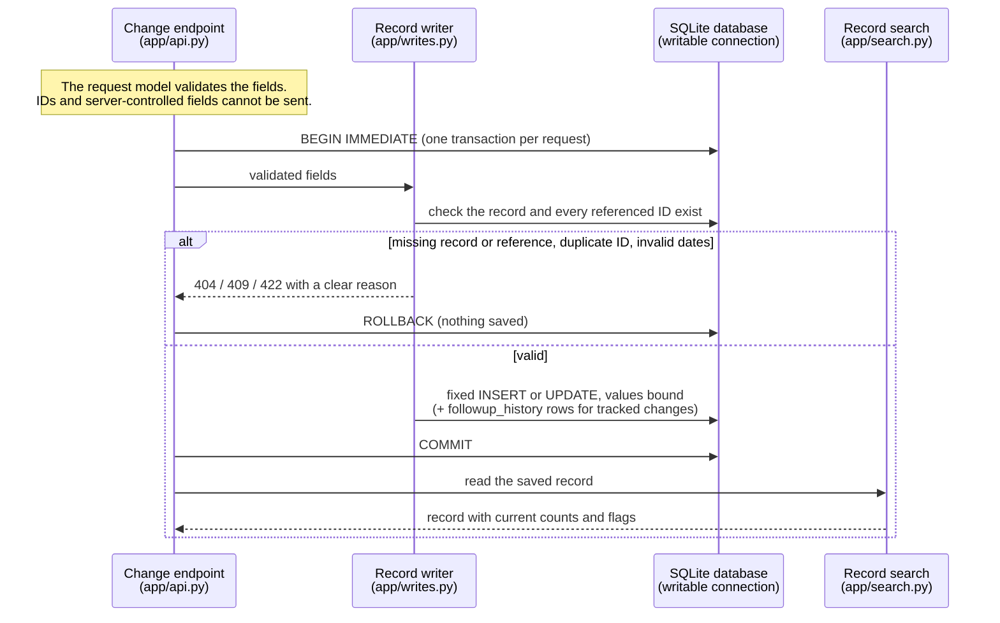
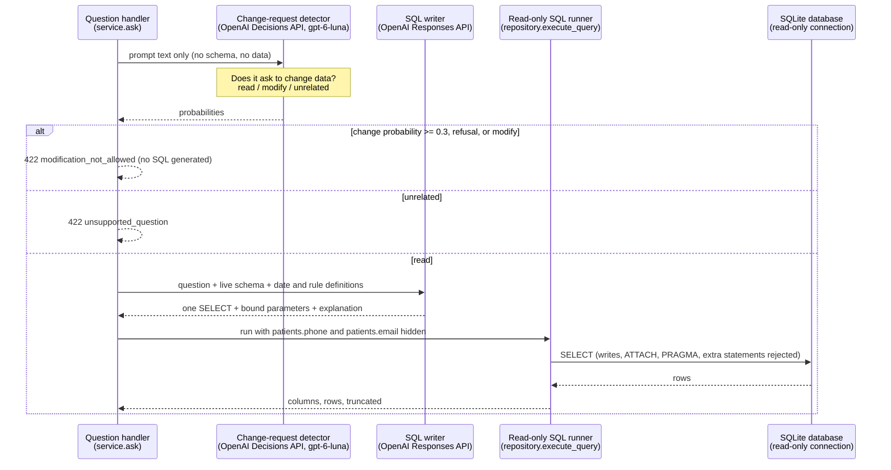

# Visit Follow-Up Tracker

After a patient visit, clinic staff often ask for a lab test, a referral, or a recheck.
When those actions live only in visit notes, some are never scheduled and some are weeks
overdue before anyone notices. The tracker keeps every follow-up in one place, shows who
owns it, and flags the ones that are **overdue**, **due soon**, or **unassigned** (no
scheduled date yet). It flags and reports; staff make every change and every care decision.

> **Synthetic data only.** Never enter real patient information.

## Features

- Dashboard and spreadsheet-style lists of patients, follow-ups, visits, episodes, and staff, colored by state
- Overdue, due-soon, and unassigned flags for any "as of" date; due-soon windows per action type in a settings file
- Statuses `open`, `done`, and `closed` (with the reason), and a history of every status, date, and staff change with who made it
- Sign-in by staff email: managers see everything, other staff see only their own follow-ups
- Import a whole data file (all or nothing), a printable report grouped by flag, and CSV downloads
- Plain-English questions, answered from what the asker may see (optional, needs an OpenAI API key)
- Synthetic data generator, verified backups, 10-year retention clean-up, Docker with a persistent volume, CI

## Quick start

Python 3.11+ and [uv](https://docs.astral.sh/uv/):

```bash
uv sync --locked
cp .env.example .env
uv run python scripts/table_generate.py
uv run python scripts/generate_synthetic_data.py --as-of "$(date +%F)"
uv run python scripts/import_data.py --file data/generated/clean_visits.json
uv run uvicorn app.main:app --reload --env-file .env
```

Open `http://localhost:8000` and sign in as the generated manager,
`elm.overseer@clinic.example.test`, or as a nurse, `birch.sample@clinic.example.test`.

To start from an empty database instead, replace the generate and import lines with
`uv run python scripts/create_manager.py --name "Clinic Manager" --email manager@clinic.example`
and add everything in the web app, or import a data file there (**Import file**). The
manager gets the ID `M001`, so it never clashes with the `S001`-style staff IDs in an import
file. For Docker, see [Docker](#docker-and-data-persistence).

## Using the tracker

### Who sees what

Staff sign in with their email. There is **no password yet**; it comes in a later release.

| | Manager (role `manager`) | Other staff |
|---|---|---|
| Sees | Every record | Their assigned follow-ups, and those patients' episodes and visits; counts cover only their follow-ups |
| Report and CSV | Everything | Their own follow-ups |
| Changes | Every record type | Status, scheduled date, staff, and notes of their own follow-ups |
| Plain-English questions | About everything | About their own follow-ups only |
| Import a file | Yes | No |

Restarting the server signs everyone out.

### Screens

- **Summary cards** open the matching filtered list when clicked.
- **Lists** have filters, search, and paging. Rows are tinted by their most urgent state;
  click a column header to sort; choose 25, 100, or 500 rows per page.
- **Status** can be changed straight from a follow-up row. Choosing **Closed** asks for the
  reason.
- **Detail panel** (click a row): the record, its related history, and an edit form. A
  follow-up's history lists every status, date, and staff change with who made it.
- **As of** re-evaluates the flags for another day.
- **Download CSV** saves every row that matches the current filters, not just the visible
  page. Follow-up files have a Yes column per flag.
- **Printable report** opens `/report`: flagged follow-ups grouped by flag, with patient ID,
  action, scheduled date, and staff. The **Print** button hides the page controls.
- **Ask** answers a question in plain English, read only, with the matching rows.
- **Import file** (managers) saves a whole data file, or lists every problem and saves
  nothing.

## Follow-up rules

Only open follow-ups are flagged. A follow-up gets at most one of the three flags.

| Flag | When, relative to the "as of" date |
|---|---|
| `overdue` | The scheduled date has passed |
| `due_soon` | Scheduled today or within the window for its action type (lab 3 days, referral 14, recheck 14) |
| `unassigned` | No scheduled date yet |

Examples, as of 2026-10-26:

| Follow-up | Flag |
|---|---|
| Lab scheduled 2026-10-25 | `overdue` |
| Lab scheduled 2026-10-26 (today) | `due_soon` |
| Referral scheduled 2026-11-05 (10 days ahead) | `due_soon` |
| Lab scheduled 2026-10-30 (4 days ahead, outside the 3-day window) | none |
| Recheck with no scheduled date | `unassigned` |
| Lab scheduled 2026-10-01, closed ("Patient did not return") | none |

## Settings file

`config/settings.json`:

```json
{
  "allowed_action_types": ["lab", "referral", "recheck"],
  "due_soon_days_by_action": {"lab": 3, "referral": 14, "recheck": 14}
}
```

Every allowed action type needs a window of 0 to 365 days. The app reads the file at
startup (restart after a change) and refuses to start if it is missing or invalid, naming
the problem.

## Data model



| Table | Columns | Purpose |
|---|---|---|
| `patients` | `patient_id`, `name`, `phone`, `email` | Patient identity and contact |
| `staff` | `staff_id`, `name`, `role`, `email` (unique; used to sign in) | Doctors, nurses, coordinators, managers |
| `episodes` | `episode_id`, `patient_id`, `description`, `opened_at`, `closed_at` | One medical issue, grouping its visits |
| `visits` | `visit_id`, `patient_id`, `episode_id`, `staff_id` (required), `visit_date`, `notes` | One encounter in an episode: a consultation, test, or treatment |
| `followups` | `followup_id`, `visit_id`, `action_type`, `due_date` (scheduled date, may be empty), `assigned_staff_id` (required), `status`, `completed_at`, `notes` | An action created during a visit |
| `followup_history` | `change_id`, `followup_id`, `field`, `old_value`, `new_value`, `changed_at`, `changed_by`, `note` | One row per change of a follow-up's status, scheduled date, or staff member |

- A visit creates zero or more follow-ups; a follow-up's patient comes from its visit.
- A visit and its episode always belong to the same patient (composite foreign key).
- `closed` means the follow-up could not be completed (unreachable, did not return, no
  results) and requires a reason in `notes`. `completed_at` is set when a follow-up
  becomes done or closed and cleared when it is reopened.
- A change and its history rows are saved in one transaction. Records are deleted only by
  the 10-year retention clean-up.

The full schema is in [`app/schema.sql`](app/schema.sql).

## Input file format

One JSON file of patients, staff, episodes, and visits, with follow-ups nested under
their visit (`data/sample_visits.json`):

```json
{
  "patients": [{"patient_id": "P001", "name": "Sample Patient"}],
  "staff": [{"staff_id": "S001", "name": "Dr. Example", "role": "doctor", "email": "doctor@clinic.example"}],
  "episodes": [{
    "episode_id": "E001", "patient_id": "P001",
    "description": "Synthetic leg-injury case", "opened_at": "2026-10-15"
  }],
  "visits": [{
    "visit_id": "V001", "patient_id": "P001", "episode_id": "E001",
    "staff_id": "S001", "visit_date": "2026-10-15", "notes": "Synthetic visit",
    "followups": [{
      "followup_id": "F001", "action_type": "lab",
      "due_date": "2026-10-20", "assigned_staff_id": "S001", "status": "open"
    }]
  }]
}
```

| Follow-up field | Required | Notes |
|---|---|---|
| `followup_id` | Yes | |
| `action_type` | Yes | `lab`, `referral`, or `recheck` |
| `due_date` | No | Scheduled date `YYYY-MM-DD`; missing means unassigned |
| `assigned_staff_id` | Yes | |
| `status` | No | `open` (default), `done`, or `closed` |
| `completed_at` | When done or closed | Timestamp with a timezone |
| `notes` | When closed | The reason it could not be completed |

A record is rejected, with its ID and the reason, for a missing ID or staff member, a
malformed date, an unknown action type or status, a closed follow-up without a reason, or
a reference to a record that does not exist, a duplicate ID, or an ID that is already
saved. If any record is rejected, the **whole file** is rejected, every reason is listed,
and nothing is saved; otherwise the file is saved in one transaction. Import with the
**Import file** button (managers), `POST /api/import`, or `scripts/import_data.py`.

## API

Interactive documentation with every filter and field is at `http://localhost:8000/docs`.
Callers never send SQL: searches and changes use fixed, parameterized SQL in
`app/search.py` and `app/writes.py`.

Every record type (`patients`, `staff`, `episodes`, `visits`, `followups`) has:

| Method | Route | Does |
|---|---|---|
| `GET` | `/api/{type}` | Search with filters, sorting, and paging |
| `GET` | `/api/{type}/export` | Every matching row as CSV |
| `GET` | `/api/{type}/{id}` | One record with its related history |
| `POST` | `/api/{type}` | Create (omit the ID to get the next free one) |
| `PATCH` | `/api/{type}/{id}` | Change only the fields sent |

Other routes:

| Method | Route | Does |
|---|---|---|
| `POST` / `GET` / `DELETE` | `/api/session` | Sign in with `{"email": ...}`, see who is signed in, sign out |
| `GET` | `/api/report`, `/report` | The report as JSON, or as a printable page |
| `GET` | `/api/dashboard` | Headline counts |
| `GET` | `/api/followups/stats` | Counts for filtered follow-ups, optionally grouped |
| `GET` | `/api/options` | Values for dropdowns, presets, and sorts |
| `GET` | `/api/schema` | The database schema as text |
| `POST` | `/api/import` | Import a file's JSON (managers; 422 with every rejection, nothing saved) |
| `POST` | `/api/ask` | A read-only question (needs `OPENAI_API_KEY`) |

Every route except `/api/session` needs a signed-in staff member.

### Searching

Filters combine with AND; repeat a parameter to match any of several values
(`action_type=lab&action_type=referral`); text filters are case-insensitive partial
matches. `as_of_date` (default today) sets the date the flags are evaluated for.

```bash
curl -b cookies 'http://localhost:8000/api/followups?flag=overdue&action_type=lab'
curl -b cookies 'http://localhost:8000/api/patients/P001'
curl -b cookies 'http://localhost:8000/api/visits?staff_name=example&visit_from=2026-10-01&sort=-visit_date'
```

(Sign in first: `curl -c cookies -H 'Content-Type: application/json' -d '{"email": "manager@clinic.example"}' http://localhost:8000/api/session`.)

| Type | Main filters |
|---|---|
| Patients | `q`, `patient_id`, `name`, `staff_id`, `has_open_episode`, visit and follow-up count ranges, last-visit and next-scheduled date ranges |
| Staff | `q`, `staff_id`, `role`, open/overdue follow-up and visit count ranges |
| Episodes | `q`, `patient_id`, `patient_name`, `description`, `status`, `staff_id`, opened/closed date ranges, days open, visit count range |
| Visits | `q`, `patient_id`, `patient_name`, `episode_id`, `staff_id`, `staff_name`, `staff_role`, `notes`, date range, follow-up count range |
| Follow-ups | `q`, record IDs and names, `action_type`, `status`, `flag`, `episode_status`, staff roles, scheduled/visit/completed date ranges, `due_within_days`, days overdue, `preset` |

Results are pages: `{"items": [...], "total": 42, "limit": 50, "offset": 0, "as_of_date": "..."}`;
`limit` is at most 1,000.

### Creating and changing records

```bash
curl -b cookies -X PATCH http://localhost:8000/api/followups/F001 \
  -H 'Content-Type: application/json' -d '{"status": "closed", "notes": "Patient unreachable"}'
```

| Type | Create (required in bold) | Update |
|---|---|---|
| Patients | `patient_id`, **`name`**, `phone`, `email` | `name`, `phone`, `email` |
| Staff | `staff_id`, **`name`**, **`role`**, `email` | `name`, `role`, `email` |
| Episodes | `episode_id`, **`patient_id`**, **`description`**, **`opened_at`**, `closed_at` | `description`, `opened_at`, `closed_at` |
| Visits | `visit_id`, **`episode_id`**, **`staff_id`**, **`visit_date`**, `notes` | `staff_id`, `visit_date`, `notes` |
| Follow-ups | `followup_id`, **`visit_id`**, **`action_type`**, `due_date`, **`assigned_staff_id`**, `notes` | `action_type`, `due_date` (`null` clears it), `assigned_staff_id`, `status`, `notes` |

Each change is one transaction; nothing is saved if any check fails. `null` clears an
optional value. Closing a follow-up without a reason is rejected.

### Plain-English questions

`POST /api/ask {"question": "Which doctor had the most rechecks last month?"}` makes two
model calls. First, the OpenAI Decisions API (`gpt-6-luna`) sees only the question and
rejects anything likely to change data (`modification_not_allowed`) or unrelated
(`unsupported_question`). Then a SQL model writes one parameterized `SELECT` from the
question, the table layout, the date, and the asker's staff ID; patient records and the
answer rows never leave the server. The response includes the SQL, its parameters, an
explanation, and the rows; the Ask tab shows the explanation and the rows. For staff who
are not managers, the query runs on a private in-memory copy of the database that holds
only their rows, with patient contact details removed, so no query can reach anyone
else's records, however it names its tables.

Neither model is trusted to keep data safe. The query runs on a read-only connection
whose SQLite [authorizer](https://www.sqlite.org/c3ref/set_authorizer.html) rejects
writes, schema changes, `ATTACH`, `PRAGMA`, and multiple statements; patient phone and
email always read as empty; and a query is stopped after two seconds or one million
steps, or when its result exceeds 4 MiB. The app's own lists and counts are stopped only
after 30 seconds, so ten years of records (about 120,000 visits) still load.

### Errors

Errors have `detail.code` and `detail.message`.

| Status | Meaning |
|---|---|
| 401 | Not signed in, or the email is not a staff member's |
| 403 | Only a manager can do this |
| 404 | Not found, or not visible to the signed-in staff member |
| 408 | A generated query took too long |
| 409 | The ID already exists, or a constraint conflict |
| 422 | Invalid filters or fields, unknown reference, rejected question, or unusable generated SQL |
| 503 | Database unavailable, or questions not configured |

## How it works

- **Rules** are a `FollowUpRule` base class with one subclass per flag. They read the date
  they are given and never the clock, so the same input and date always give the same flags.
- **Access**: every search query reads `followups`, `patients`, `episodes`, and `visits`
  through same-named common table expressions that keep only the signed-in staff member's
  rows (managers keep all). Filters, counts, details, CSV files, and the report therefore
  share one rule.
- **Reads** run on a read-only connection with the authorizer; **writes** run in one
  `BEGIN IMMEDIATE` transaction per request.

### Search



### Change



### Question



## Configuration

| Variable | Default | Purpose |
|---|---|---|
| `FOLLOWUP_DB_PATH` | `data/followups.db` | SQLite database path |
| `OPENAI_API_KEY` | unset | Enables plain-English questions; never commit it |
| `OPENAI_MODELS` | | Models the key can use, comma separated; the first writes SQL |
| `OPENAI_SQL_MODEL` | | Overrides the SQL model |

Uvicorn reads `.env` only with `--env-file .env`. Keep `pyproject.toml`, `uv.lock`, and the
requirements files in step when changing dependencies.

## Scripts

Details in [`scripts/README.md`](scripts/README.md). The database scripts take `--db-path` or use `FOLLOWUP_DB_PATH`.

| Script | Does |
|---|---|
| `table_generate.py` | Creates the tables; keeps existing data; does **not** migrate an older database, so re-create it after a schema change |
| `generate_synthetic_data.py --as-of YYYY-MM-DD` | Writes a clean file and a file with deliberate bad rows to `data/generated/`; the same seed and date give the same files |
| `import_data.py --file ...` | Imports a whole file, or prints every problem and saves nothing |
| `create_manager.py --name ... --email ...` | Adds a manager who can sign in, for a database that has none |
| `backup_db.py` | Copies the live database to `backups/`, runs `PRAGMA integrity_check`, and test-restores it |
| `delete_old_records.py [--dry-run]` | Deletes visits older than 10 years with their follow-ups and history, and patients and episodes left empty |

## Docker and data persistence

The container runs as a non-root user on port 8000. The database lives on a named volume
at `/data`, so it survives container replacement.

```bash
docker compose build
docker compose run --rm app python scripts/table_generate.py
docker compose run --rm app python scripts/create_manager.py --name "Clinic Manager" --email manager@clinic.example
docker compose up -d
docker compose exec app python scripts/backup_db.py --output /data/backups   # a verified backup on the volume
curl --fail http://localhost:8000/health
```

After pulling new code, `docker compose up -d --build` replaces the container and keeps
the database. `docker compose down --volumes` deletes the database. Compose passes
`OPENAI_API_KEY`, `OPENAI_MODELS`, and `OPENAI_SQL_MODEL` from your shell or `.env` to the
container; without them, everything but plain-English questions works.

Without Compose:

```bash
docker build -t visit-followup-tracker:dev .
docker volume create followup_data
docker run --rm -v followup_data:/data -e FOLLOWUP_DB_PATH=/data/followups.db \
  visit-followup-tracker:dev python scripts/table_generate.py
docker run -d --name followup-app -p 8000:8000 -v followup_data:/data \
  -e FOLLOWUP_DB_PATH=/data/followups.db visit-followup-tracker:dev
```

Mount the directory, not the database file, so SQLite's side files persist too.

## Releases, upgrade, rollback, and backup

| Version | Contents |
|---|---|
| 1.0.0 | Everything above, for internal use with email-only sign-in |
| 1.1.0 | Adds passwords to sign-in |

No release is tagged yet; see [CHANGELOG.md](CHANGELOG.md). Each release gets a Git tag, an
image tag, and a changelog entry, and 1.1.0 must keep the 1.0.0 database readable.

```bash
# Upgrade: replace the container, reuse the volume.
docker stop followup-app && docker rm followup-app
docker run -d --name followup-app -p 8000:8000 -v followup_data:/data \
  -e FOLLOWUP_DB_PATH=/data/followups.db visit-followup-tracker:1.1.0

# Roll back the same way with visit-followup-tracker:1.0.0.
```

After a rollback, check that a follow-up and its history created before the upgrade are
still there. Run `scripts/backup_db.py` before an upgrade; it uses
`sqlite3.Connection.backup()` (a file copy of a live database can be torn).

## Testing and CI

```bash
uv run pytest -q
```

Tests use temporary synthetic databases and a fake model, so they make no external calls.
CI (`.github/workflows/ci.yml`, check name `test`) runs them on every pull request and
push to `main`; branch protection requires it to pass before merging.

## Repository layout

```text
app/
  main.py, api.py      routes, printable report page
  auth.py              sign-in and who sees what
  search.py, writes.py fixed SQL for reads and changes
  repository.py        restricted read-only SQL runner
  service.py           business operations and the report
  rules/               FollowUpRule and its subclasses
  ingestion/           record validation and settings loading
  ai/                  plain-English questions
  export.py            CSV downloads
  schema.sql           database schema
  templates/, static/  web pages, scripts, styles
config/settings.json   rule settings
data/                  sample data; generated files go in data/generated/
scripts/               setup, data generator, import, backup, retention clean-up
tests/                 unit/ and integration/
docs/                  team decisions and remaining work
presentation/          team presentation page
```

## Security and limitations

- Sign-in has no password yet, because 1.0.0 is for internal use: anyone who knows a staff
  email can act as that person. Passwords come in 1.1.0; real use also needs a privacy review.
- Sessions live in server memory, so the app must run as a single process.
- The clinic keeps records for 10 years (its own policy). Run `delete_old_records.py`
  regularly; nothing else deletes records.
- SQLite suits this clinic's size, not many simultaneous writers.
- The plain-English answers are a convenience; the rules and fixed queries are the source
  of truth.

## Team

Team 3: Sanket Deshmukh (data intake, validation, rules), Jihyung Park (storage, report,
command line), Tejdeep Pathipati (Docker, release, CI). Decisions, remaining work, and the
demo plan are in [docs/](docs/README.md).
